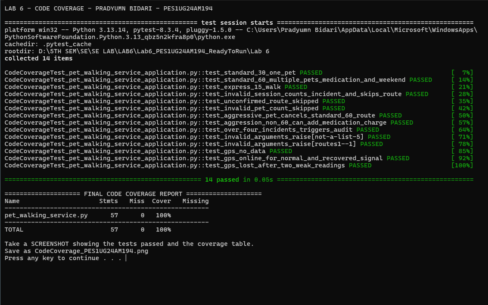
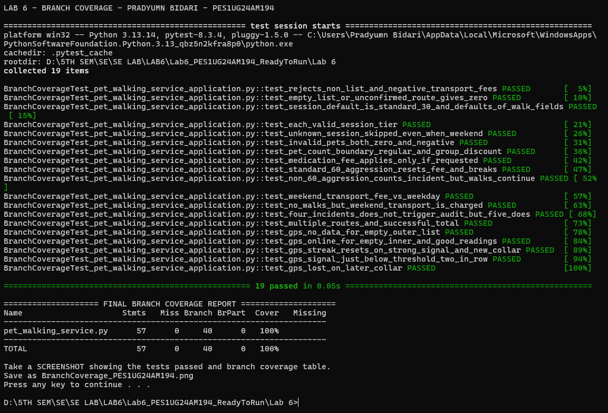

# SE Lab 6 - Code Coverage and Branch Coverage

**Student:** Pradyumn Bidari  
**SRN:** PES1UG24AM194  
**Course:** Software Engineering  
**Application:** Pet Walking Service

## Objective

To measure and improve test coverage of the Pet Walking Service application using **pytest** and **coverage.py**. The tests examine both executed lines of code and decision branches.

## Files in This Folder

| File | Description |
| --- | --- |
| `CodeCoverageTest_pet_walking_service_application.py` | Tests for line (statement) coverage. |
| `BranchCoverageTest_pet_walking_service_application.py` | Tests for decisions and conditional branches. |
| `CODE_COVERAGE.png` | Screenshot of code coverage output. |
| `BRANCH_COVERAGE.png` | Screenshot of branch coverage output. |
| `README.md` | This project guide. |

## Requirements

- Python 3.8 or newer
- pytest
- coverage.py
- The application module `pet_walking_service.py`

Install the test tools in Windows CMD:

```cmd
py -m pip install pytest coverage
```

**Important:** The test files import `pet_walking_service`, but `pet_walking_service.py` is not currently stored in this `SE_LAB6` folder. To run the tests locally, put the application file in the same folder as the two test files. The original application can be found in the [assigned Lab 6 repository](https://github.com/SETAPESU26/L6_L7_13_pet_walking_service/blob/main/Lab%206/pet_walking_service.py).

## How to Run Line Coverage

Open CMD inside the folder containing the application and test files, then run:

```cmd
py -m coverage erase
py -m coverage run --source=pet_walking_service -m pytest -v CodeCoverageTest_pet_walking_service_application.py
py -m coverage report -m
```

This reports how many executable code statements were exercised by the tests.

## How to Run Branch Coverage

Run the branch tests separately to keep the measurements independent:

```cmd
py -m coverage erase
py -m coverage run --branch --source=pet_walking_service -m pytest -v BranchCoverageTest_pet_walking_service_application.py
py -m coverage report -m
```

Branch coverage checks whether different outcomes of conditional statements and loops were exercised.

> If `py` is not available on your computer, use `python` in the commands instead.

## Features Tested

- Walk session pricing (`express_15`, `standard_30`, and `standard_60`)
- Route confirmation and invalid input validation
- Pet count boundaries, group discounts, and medication charges
- Weekend transport fees
- Aggression alerts and incident audits
- GPS collar status: `NO_DATA`, `ONLINE`, and `LOST_SIGNAL_ALERT`

## Coverage Evidence

### Code Coverage



### Branch Coverage



## Conclusion

The test suites cover normal operations, invalid inputs, boundary conditions, and alternate decision paths in the Pet Walking Service application. The screenshots above document the coverage results generated during Lab 6.
